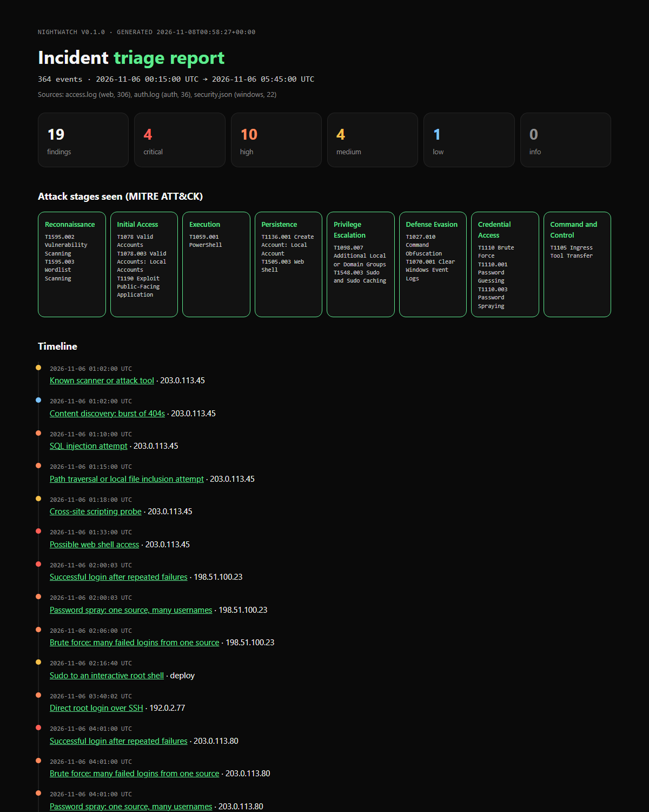

# nightwatch

**Log triage for the night shift.** Point nightwatch at raw logs and it hunts for attacker behavior, ties findings across sources, maps them to [MITRE ATT&CK](https://attack.mitre.org), and writes an incident report you can hand off.

```
$ nightwatch scan samples --year 2026
nightwatch v0.1.0
  access.log                   web          306 events
  auth.log                     auth          36 events
  security.json                windows       22 events
  364 events from 2026-11-06 00:15:00 UTC to 2026-11-06 05:45:00 UTC

4 critical  10 high  4 medium  1 low

 CRITICAL  Possible web shell access  NW-011
           src_ip=203.0.113.45  5 events  2026-11-06 01:33:00 UTC → 2026-11-06 01:34:40 UTC
           ATT&CK T1505.003 Web Shell

 CRITICAL  Successful login after repeated failures  NW-003
           src_ip=198.51.100.23  20 events  2026-11-06 02:00:03 UTC → 2026-11-06 02:14:07 UTC
           19 matching events, then success within 1800s
           ATT&CK T1110 Brute Force, T1078 Valid Accounts
 ...
```



## What it does

- **Reads the logs you actually have.** Linux `auth.log`, Apache/Nginx access logs, and Windows Security events. The format is detected from the content.
- **Normalizes everything** into one event shape, so a single rule like "many failed logins from one source" works on SSH and Windows RDP alike.
- **Runs 16 detection rules** written in plain TOML, each mapped to ATT&CK techniques and paired with a response step.
- **Reports three ways:** colored terminal output, JSON for scripts or a SIEM, and a single-file HTML report with an ATT&CK stage map, a timeline, and evidence pointing back to the exact file and line.
- **Fails a pipeline on demand.** `--fail-on high` exits 1 when something serious is found.

No dependencies: Python 3.11+ standard library only.

## Quick start

```bash
git clone https://github.com/WooShied/nightwatch
cd nightwatch
python -m nightwatch scan samples --year 2026
python -m nightwatch scan samples --year 2026 -f html -o report.html
```

Or install it as a command:

```bash
pip install .
nightwatch scan /var/log/auth.log /var/log/nginx/access.log -v
```

| Command | What it does |
|---|---|
| `nightwatch scan PATH...` | Scan files or folders. `-f text\|json\|html`, `-o FILE`, `-v` for evidence and response steps |
| `nightwatch rules` | List every rule with its severity and ATT&CK mapping |
| `nightwatch explain NW-003` | What a rule looks for, how to respond, and links to ATT&CK |
| `--min-severity medium` | Hide anything below a severity |
| `--fail-on high` | Exit 1 if any finding is at or above a severity |
| `--rules my-rules.toml` | Add your own rules (repeatable) |
| `--year 2025` | Year for syslog timestamps, which don't include one |

## The sample attack

`samples/` holds three synthetic logs that tell one overnight story, mixed with normal traffic. Everything is made up: IPs come from the RFC 5737 documentation ranges and hosts use `example.com`. Regenerate them with `python scripts/make_samples.py`.

| Time (UTC) | Source | What happens | Caught by |
|---|---|---|---|
| 01:02 | web | Nikto scan from 203.0.113.45, burst of 404s | NW-009, NW-010 |
| 01:10 | web | sqlmap SQL injection, path traversal, XSS probes | NW-006, NW-007, NW-008 |
| 01:31 | web | PHP web shell uploaded and used to run commands | NW-011 |
| 02:00 | ssh | Username spray, then guessing `deploy`'s password | NW-002, NW-001 |
| 02:14 | ssh | Login succeeds; `sudo /bin/bash` | NW-003, NW-005 |
| 03:40 | ssh | Direct root login | NW-004 |
| 04:01 | windows | RDP brute force succeeds as `helpdesk` | NW-001, NW-002, NW-003 |
| 04:09 | windows | Encoded PowerShell, `certutil` download | NW-015, NW-016 |
| 04:12 | windows | Backdoor `svc-backup` created and made admin | NW-012, NW-013 |
| 04:20 | windows | Security log cleared | NW-014 |

The test suite checks that every stage is caught and that the normal traffic stays quiet.

## Rules

| ID | Severity | Detects | ATT&CK |
|---|---|---|---|
| NW-001 | high | Many failed logins from one source | T1110.001 |
| NW-002 | high | Password spray: one source, many usernames | T1110.003 |
| NW-003 | critical | Successful login after repeated failures | T1110, T1078 |
| NW-004 | high | Direct root login over SSH | T1078.003 |
| NW-005 | medium | Sudo to an interactive root shell | T1548.003 |
| NW-006 | high | SQL injection attempt | T1190 |
| NW-007 | high | Path traversal / local file inclusion | T1190 |
| NW-008 | medium | Cross-site scripting probe | T1190 |
| NW-009 | medium | Known scanner or attack tool | T1595.002 |
| NW-010 | low | Burst of 404s (content discovery) | T1595.003 |
| NW-011 | critical | Script executed from an upload folder (web shell) | T1505.003 |
| NW-012 | medium | New local account created | T1136.001 |
| NW-013 | high | Account added to a privileged group | T1098.007 |
| NW-014 | critical | Security event log cleared | T1070.001 |
| NW-015 | high | Encoded PowerShell command | T1059.001, T1027.010 |
| NW-016 | high | Download cradle / living-off-the-land transfer | T1105 |

### Writing your own

Rules are TOML. There are four types:

| Type | Fires when | Example |
|---|---|---|
| `match` | Any event matches | Log cleared, web shell request |
| `threshold` | `threshold` matching events from one `group_by` value inside `window` seconds | Brute force |
| `distinct` | `threshold` *different* values of `distinct` from one group inside `window` | Password spray |
| `sequence` | `threshold` events matching `where`, then one matching `then`, same group, inside `window` | Failures followed by a success |

```toml
[[rule]]
id = "LOCAL-001"
title = "Login from outside business hours by a service account"
severity = "medium"
type = "match"
attack = ["T1078"]
where = { action = "login_success" }
where_regex = { user = '^svc-' }
group_by = "user"
description = "A service account logged in interactively."
response = "Confirm the login was automated and expected."
```

`where` matches exact values (or any value in a list); `where_regex` matches regular expressions. Fields you can use: `source`, `action`, `user`, `src_ip`, `host`, plus per-source fields listed at the top of [`rules/default.toml`](nightwatch/rules/default.toml).

## Exporting Windows Security events

Run in an elevated PowerShell to export recent events in the shape nightwatch reads:

```powershell
Get-WinEvent -FilterHashtable @{LogName='Security'; Id=4624,4625,4688,4720,4732,1102} -MaxEvents 5000 |
  ForEach-Object {
    $x = [xml]$_.ToXml(); $d = @{}
    $x.Event.EventData.Data | ForEach-Object { $d[$_.Name] = $_.'#text' }
    [pscustomobject]@{ TimeCreated = $_.TimeCreated.ToUniversalTime().ToString('o'); Id = $_.Id; Computer = $_.MachineName; Data = $d }
  } | ConvertTo-Json -Depth 4 | Out-File security.json -Encoding utf8
```

Process command lines (event 4688) only appear if "Include command line in process creation events" is enabled in audit policy.

## Design notes

- **Logs are hostile input.** URLs and user agents are attacker-controlled. The HTML report escapes every value and ships a `Content-Security-Policy` of `default-src 'none'`, so a `<script>` payload in a log shows up as text and can never run. A test proves it.
- **Decode before matching.** Attackers URL-encode payloads, sometimes twice. Web rules match against the decoded path.
- **Evidence over alerts.** Every finding keeps the original lines with `file:line` references, so an analyst can verify it rather than trust it.
- **One vocabulary across sources.** `login_failed` means the same thing whether it came from sshd or event 4625, which is what lets brute force, spray, and success-after-failure rules work everywhere.
- **No dependencies.** Nothing to install, nothing to patch, and no supply-chain risk for a tool that reads sensitive logs.

Generated reports contain whatever is in your logs, so `.gitignore` excludes them.

## Development

```bash
python -m unittest discover -s tests -v
```

CI runs the tests on Linux and Windows across Python 3.11 to 3.13, and publishes the sample HTML report as a build artifact.

## Roadmap

- More sources: Windows Sysmon, AWS CloudTrail, Okta system log
- GeoIP and threat-intel enrichment for source IPs
- Sigma rule import

## License

MIT
